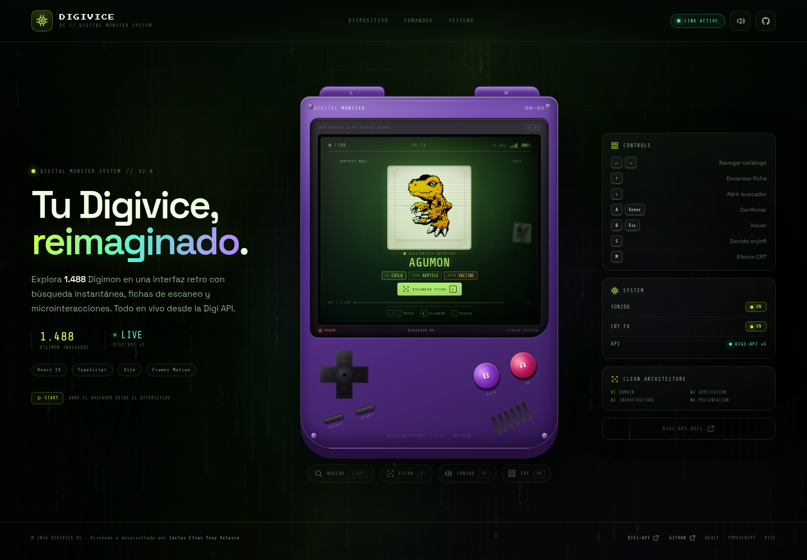
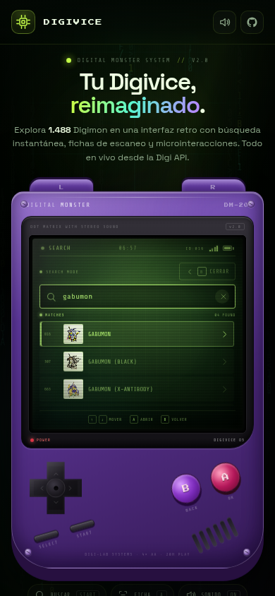
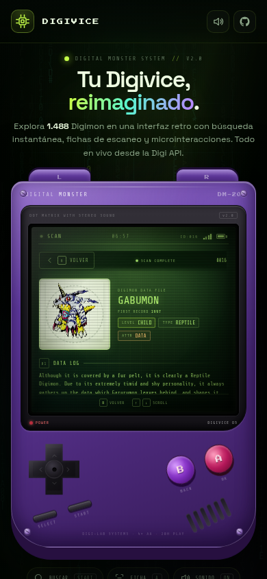

# DIGIVICE OS · Digivice estilo GameBoy

Aplicación web interactiva que simula un **Digivice retro con estética GameBoy**. Explora el catálogo completo de Digimon, busca por nombre o ID, abre fichas de escaneo y navega por evoluciones, todo dentro de una pantalla LCD animada.

El proyecto fue reconstruido desde cero con **React 19, TypeScript, Vite y Framer Motion**, siguiendo una arquitectura modular por capas y un diseño totalmente responsive.

**Demo:** https://velasco-c.github.io/Taller-2_JavaScript/

**Datos en vivo:** [Digi API](https://digi-api.com/)

---

## 📸 Vista previa

### Catálogo en escritorio



### Búsqueda y detalle en móvil

<p align="center">
  
  
</p>

---

## ✨ Características

- **Catálogo paginado:** carga los Digimon de la Digi API de 24 en 24 con scroll infinito y navegación animada.
- **Búsqueda instantánea:** filtra por nombre o por ID numérico, con debounce y estados de carga, vacío y error.
- **Ficha de escaneo:** imagen, nivel, atributo, tipo, campos, habilidades, descripción y evoluciones.
- **Navegación por evoluciones:** abre directamente la ficha de un Digimon evolucionado y vuelve al detalle anterior.
- **Controles de dispositivo:** D-pad, botones A/B, Start/Select y gatillos L/R, además de atajos de teclado.
- **Efectos CRT y sonido:** activa o desactiva el efecto de pantalla y los sonidos de la interfaz.
- **Animaciones cuidadas:** arranque tipo BIOS, transiciones entre pantallas, glitch, scanlines, lluvia de caracteres y microinteracciones.
- **Responsive:** layout adaptado a escritorio, tablet y móvil sin desbordamiento horizontal.
- **Accesibilidad:** navegación por teclado, etiquetas ARIA, foco visible y respeto por `prefers-reduced-motion`.

---

## 🎮 Controles

| Acción | Teclado | Dispositivo |
| --- | --- | --- |
| Navegar por el catálogo | Flechas izquierda / derecha | D-pad · botones L / R |
| Ver detalle del Digimon | Flecha arriba | Botón A |
| Abrir el buscador | Flecha abajo | Start |
| Confirmar / seleccionar | Enter | Botón A |
| Volver / cerrar | Escape | Botón B |
| Activar o silenciar sonido | `S` | Select |
| Activar o desactivar CRT | `M` | — |

También puedes usar los botones en pantalla. En móvil, el dock inferior permite abrir el buscador, ver la ficha, cambiar el sonido y el efecto CRT.

---

## 🛠️ Tecnologías

- **React 19** + **TypeScript 5.9**
- **Vite 8** como bundler y servidor de desarrollo
- **Framer Motion 14** para animaciones y transiciones
- **CSS Modules globales por capas** con variables de diseño y `clamp()`
- **Digi API v1** como fuente de datos
- **GitHub Actions + GitHub Pages** para despliegue automático

---

## 🧱 Arquitectura

El código está organizado por capas, con dependencias que apuntan hacia el dominio:

```text
src/
├── app/                         # Composition root y composición de la página
│   ├── App.tsx
│   └── container.ts
├── core/
│   ├── domain/                  # Entidades, errores y contratos
│   │   ├── entities/
│   │   ├── errors/
│   │   └── repositories/
│   └── application/             # Casos de uso
│       └── use-cases/
├── infrastructure/              # Implementaciones concretas
│   ├── api/                     # Cliente HTTP, DTOs, mappers y repositorio
│   ├── config/                  # Configuración de la API
│   └── repositories/            # Repositorio con caché en memoria
├── presentation/                # UI, estilos y hooks
│   ├── components/
│   │   ├── background/
│   │   ├── digivice/
│   │   ├── layout/
│   │   ├── screen/
│   │   └── ui/
│   ├── hooks/
│   └── styles/
└── shared/                      # Constantes y utilidades reutilizables
```

### Capas

- **Domain:** define `Digimon`, errores de dominio y el contrato `DigimonRepository`.
- **Application:** casos de uso `getCatalogPage`, `getDetail` y `searchDigimons`.
- **Infrastructure:** implementa el contrato con `DigimonApiRepository`, mapea los DTOs de la API y añade caché con `CachedDigimonRepository`.
- **Presentation:** componentes, hooks de estado, máquina de pantallas (`boot → catalog → search → detail`) y estilos.
- **App:** única capa que conoce las implementaciones concretas y las inyecta en la UI.

---

## 🚀 Ejecución local

### Requisitos

- **Node.js 20.19+** o **22.12+**
- **npm 10+**
- Conexión a internet para consultar la Digi API

### Pasos

```bash
git clone https://github.com/Velasco-c/Taller-2_JavaScript.git
cd Taller-2_JavaScript
npm install
npm run dev
```

La aplicación quedará disponible en `http://localhost:5173/`.

### Scripts disponibles

| Script | Descripción |
| --- | --- |
| `npm run dev` | Inicia el servidor de desarrollo con HMR. |
| `npm run build` | Verifica TypeScript y genera la build de producción en `dist/`. |
| `npm run preview` | Sirve localmente la build de producción. |
| `npm run typecheck` | Ejecuta `tsc --noEmit` sin generar archivos. |
| `npm run deploy` | Genera la build y la publica en la rama `gh-pages` con `gh-pages`. |

### Variables de entorno

La URL de la API se puede sobreescribir con:

```bash
VITE_DIGI_API_URL=https://digi-api.com/api/v1
```

Si no se define, se usa `https://digi-api.com/api/v1`.

---

## 🔌 API utilizada

**Digi API v1** · https://digi-api.com/api/v1/digimon

| Uso | Endpoint |
| --- | --- |
| Catálogo paginado | `GET /digimon?page=0&pageSize=24` |
| Detalle por ID o nombre | `GET /digimon/{idOrName}` |
| Búsqueda por nombre | `GET /digimon?name=agumon` |
| Búsqueda por ID | `GET /digimon/{id}` |

La capa de infraestructura normaliza las respuestas, maneja errores HTTP y cachea en memoria las consultas repetidas para evitar peticiones innecesarias.

---

## 🌐 Despliegue en GitHub Pages

El repositorio incluye el flujo de trabajo [`.github/workflows/deploy.yml`](.github/workflows/deploy.yml):

1. En GitHub, abre **Settings → Pages**.
2. En **Build and deployment → Source**, selecciona **GitHub Actions**.
3. Haz push a la rama `main` o ejecuta el workflow manualmente desde **Actions → Deploy to GitHub Pages**.

Vite está configurado con `base: './'`, por lo que los assets usan rutas relativas y la build funciona tanto en GitHub Pages como en cualquier subdirectorio o dominio propio.

La aplicación se publicará en:

```text
https://velasco-c.github.io/Taller-2_JavaScript/
```

### Alternativa manual

```bash
npm run deploy
```

Este comando genera `dist/` y publica su contenido en la rama `gh-pages`.

---

## ♿ Accesibilidad y rendimiento

- Controles completos por teclado y botones con etiquetas `aria-label`.
- `aria-live` para anunciar cambios de pantalla y resultados de búsqueda.
- Enlace para saltar al contenido principal.
- Respeto por `prefers-reduced-motion` y por el modo de movimiento reducido configurado en el sistema.
- Imágenes con `loading="lazy"` y `decoding="async"` en el catálogo.
- Caché en memoria para búsquedas y detalles repetidos.
- Build de producción con Vite, TypeScript estricto y sin errores de tipo.

---

## 📁 Capturas adicionales

Las capturas de versiones anteriores se conservan en [`docs/capturas/`](docs/capturas/).

---

## 🎓 Créditos

Proyecto desarrollado por **Carlos Elías Tzoy Velasco** como parte del **Taller #2 de JavaScript** bajo la mentoría de **Campuslands**.

- **API:** [Digi API](https://digi-api.com/)
- **Repositorio:** [Velasco-c/Taller-2_JavaScript](https://github.com/Velasco-c/Taller-2_JavaScript)
- **Contacto:** carlos.velasco.est@gmail.com

---

**Última actualización:** Noviembre 2026
